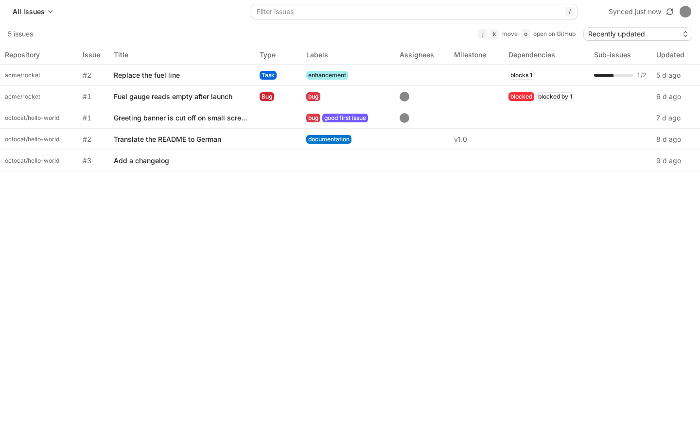
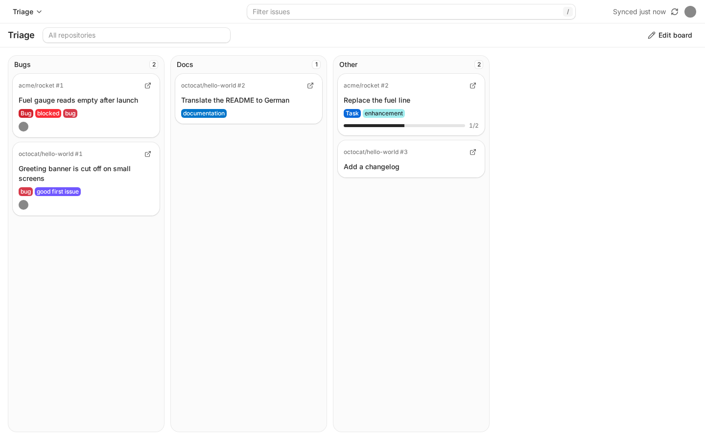
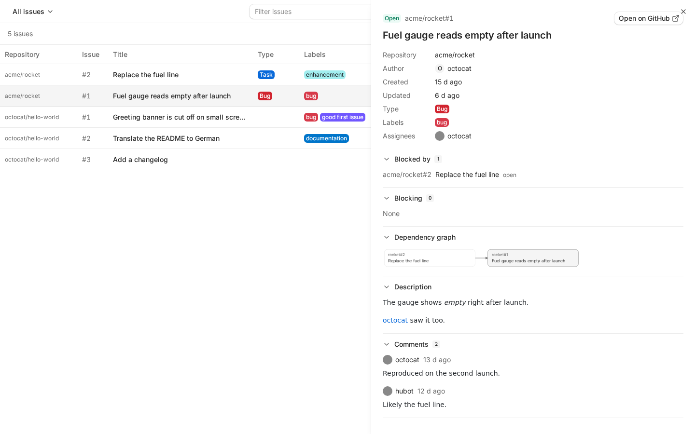

# Crossboard

One overview of all open GitHub issues across your repositories and organizations, with cross-repo dependencies, custom Kanban boards and GitHub-style filtering.

Crossboard is a self-hosted web app. You install its own GitHub App on your personal account and on any organizations you like, and Crossboard then keeps every open issue of those repositories in one list:

- **One list for everything.** Every open issue with its labels, assignees, issue type, milestone, parent and sub-issues, searchable with GitHub's issue search syntax (`assignee:@me`, `label:bug`, `repo:acme/rocket`, `is:blocked`, with `AND`, `OR` and parentheses). The filter is evaluated locally, so it costs no GitHub API calls.
- **Dependencies.** Which issue is blocked by which, and which one blocks which, across repositories, in the list, in the detail panel and in a small dependency graph.
- **Custom Kanban boards.** Each column is a filter query. An issue lands in the first column whose filter matches it, and sub-issues fold under their parent.
- **Deep links to GitHub** from every issue, label, user and repository.

Every user sees only the repositories they can access on GitHub, and Crossboard never writes to GitHub.

|                         The list                          |                       A board                        |
| :-------------------------------------------------------: | :--------------------------------------------------: |
|  |  |



The screenshots come from Crossboard's end-to-end test setup, which serves fixture data from a fake GitHub. They show no real repositories.

## Limits

- **github.com only.** GitHub Enterprise Server is not supported.
- **Open issues only.** Pull requests, closed issues and archived repositories are not synced.
- **Read-only.** Crossboard asks the App for _Issues: read_ and _Metadata: read_ and nothing else. It cannot change labels, statuses, comments or anything else on GitHub.
- **Desktop-first.** The interface is designed for screens of 1024 px and wider, in English. There is no mobile layout.

## Self-hosting

Crossboard runs as one container with one SQLite file. You need a Docker host, a way to give it a URL (see [Running without webhooks](#running-without-webhooks) if it has no public one) and a GitHub account.

### 1. Pull the image

```sh
docker pull ghcr.io/mdg-labs/crossboard:latest
```

`:<version>` is published by each release; `:latest` moves only when the release is the highest stable version tag, so pin `:<version>` for a deterministic pull. Both are multi-arch (`linux/amd64` and `linux/arm64`). `:nightly` follows the `main` branch and is `linux/amd64` only.

### 2. Run it with Docker Compose

[`docker-compose.yml`](docker-compose.yml) in this repository is a ready-made example. It builds the image from the checkout; to run the published image instead, use this file:

```yaml
services:
  crossboard:
    image: ghcr.io/mdg-labs/crossboard:latest
    restart: unless-stopped
    ports:
      - "3000:3000"
    environment:
      CROSSBOARD_PUBLIC_URL: "<your public URL>"
      CROSSBOARD_APP_SECRET: "<your app secret>"
      # At least one of the two allowlists is required (comma-separated logins).
      CROSSBOARD_ALLOWED_USERS: "<your GitHub login>"
      # CROSSBOARD_ALLOWED_ORGS: "<your GitHub organization>"
    volumes:
      - crossboard-data:/data

volumes:
  crossboard-data:
```

Replace every `<...>` placeholder before the first start:

- `CROSSBOARD_PUBLIC_URL` is the address your browser and GitHub use to reach Crossboard, for example your reverse proxy's `https://` address. Put TLS in front of the container; session cookies are `Secure` everywhere except on `http://localhost`.
- `CROSSBOARD_APP_SECRET` is a random secret of at least 32 characters. Generate it with `openssl rand -hex 32`, keep it, and read [what changing it does](#the-app-secret).

The server refuses to start, and names the variable, while a value is missing or invalid, and while both allowlists are empty. Then start it:

```sh
docker compose up -d
```

The container listens on port 3000 and reports its health at `/api/health`.

### 3. First-run setup

Nobody registers the GitHub App by hand. With no App credentials configured, Crossboard serves only `/setup` and redirects everything else there.

1. Read the setup token. The server writes it to `/data/setup-token` (readable by its owner only), not to the log:

   ```sh
   docker compose exec crossboard cat /data/setup-token
   ```

2. Open `<your public URL>/setup` and enter the token. A new token is generated on every start, so after a restart read the file again.
3. Enter the organization login that should own the App, or leave the field empty for your personal account.
4. Crossboard sends you to GitHub with a prefilled App manifest (permissions, events and URLs already set). Confirm the name and click **Create GitHub App**.
5. GitHub returns you to Crossboard, which stores the App's credentials encrypted in its database and closes setup. The token file is removed.

The App is registered as public, because a private GitHub App can only be installed by its owner. Crossboard therefore restricts who may sign in and which installations it syncs to the accounts in `CROSSBOARD_ALLOWED_USERS` and `CROSSBOARD_ALLOWED_ORGS`.

### 4. Install the App

Sign in with GitHub. Crossboard opens its settings page, which lists the accounts that have the App installed and links to GitHub's installation page.

1. Install the App on your personal account and on each organization whose issues you want, choosing all repositories or a selection. Organization owners may have to approve the installation.
2. Back on the settings page, each installation shows as active or not. An installation is synced when its account is in `CROSSBOARD_ALLOWED_ORGS`, or when an allowed user who can access it has signed in. Installations by anyone else are recorded and ignored.
3. The first sync of each repository starts in the background. The settings page shows the state of every repository and the remaining GitHub API budget of each installation.

### Using existing credentials instead of setup

To reuse a GitHub App that already exists, for example when moving an instance, set all six variables. The setup page is then never served. Setting only some of them is a startup error.

```yaml
environment:
  GITHUB_APP_ID: "<your app id>"
  GITHUB_APP_SLUG: "<your app slug>"
  GITHUB_CLIENT_ID: "<your client id>"
  GITHUB_CLIENT_SECRET: "<your client secret>"
  GITHUB_PRIVATE_KEY: "<your private key, the full PEM text>"
  GITHUB_WEBHOOK_SECRET: "<your webhook secret>"
```

`GITHUB_PRIVATE_KEY` holds the PEM file's text including its `BEGIN` and `END` lines and real line breaks; a YAML block scalar (`|`) or an `env_file` keeps them. The App must match what the setup manifest would create:

- Public, with the permissions _Issues: read_ and _Metadata: read_.
- Callback URL `<your public URL>/auth/callback` and setup URL `<your public URL>/settings`.
- Webhook URL `<your public URL>/webhooks/github` with the same secret as `GITHUB_WEBHOOK_SECRET`, subscribed to `issues`, `issue_comment`, `label`, `sub_issues`, `issue_dependencies` and `repository`, unless you run without webhooks.

### Running without webhooks

Webhooks keep the data fresh without polling, but GitHub must be able to reach `<your public URL>/webhooks/github`. An instance without a public URL, for example on a laptop, sets `CROSSBOARD_WEBHOOKS=false`. The setup manifest then creates the App with its webhook turned off, and Crossboard polls for changes instead, every 2 minutes by default. `http://localhost` works as the public URL, because GitHub OAuth accepts it as a callback.

```yaml
environment:
  CROSSBOARD_PUBLIC_URL: "http://localhost:3000"
  CROSSBOARD_WEBHOOKS: "false"
```

## Configuration

Configuration comes from environment variables only, validated at startup.

| Variable                                                                                                                      | Default                                        | Meaning                                                                                          |
| ----------------------------------------------------------------------------------------------------------------------------- | ---------------------------------------------- | ------------------------------------------------------------------------------------------------ |
| `CROSSBOARD_PUBLIC_URL`                                                                                                       | required                                       | Base URL users and GitHub reach the instance at, `http` or `https`                               |
| `CROSSBOARD_APP_SECRET`                                                                                                       | required, at least 32 characters               | Key material for encryption at rest                                                              |
| `CROSSBOARD_ALLOWED_USERS`                                                                                                    | empty                                          | Comma-separated GitHub logins that may sign in                                                   |
| `CROSSBOARD_ALLOWED_ORGS`                                                                                                     | empty                                          | Comma-separated organization logins whose members may sign in and whose installations are synced |
| `CROSSBOARD_DATA_DIR`                                                                                                         | `/data`                                        | Directory of `crossboard.db`                                                                     |
| `CROSSBOARD_WEBHOOKS`                                                                                                         | `true`                                         | Whether webhooks are expected; `false` for instances without a public URL                        |
| `CROSSBOARD_RECONCILE_INTERVAL_MIN`                                                                                           | `15`, or `2` when webhooks are off             | Minutes between polling rounds, from 1 to 1440                                                   |
| `PORT`                                                                                                                        | `3000`                                         | HTTP port                                                                                        |
| `LOG_LEVEL`                                                                                                                   | `info`                                         | One of `fatal`, `error`, `warn`, `info`, `debug`, `trace`, `silent`                              |
| `GITHUB_APP_ID`, `GITHUB_APP_SLUG`, `GITHUB_CLIENT_ID`, `GITHUB_CLIENT_SECRET`, `GITHUB_PRIVATE_KEY`, `GITHUB_WEBHOOK_SECRET` | unset                                          | App credentials instead of the setup flow; all six or none                                       |
| `CROSSBOARD_GITHUB_API_URL`, `CROSSBOARD_GITHUB_WEB_URL`                                                                      | `https://api.github.com`, `https://github.com` | For tests against a fake GitHub only; not a supported way to use another host                    |

At least one of the two allowlists must be set, and matching is case-insensitive. Because the container's `CROSSBOARD_DATA_DIR` is already `/data`, you rarely set it or `PORT`; change the published port in the compose file instead.

## Data and backups

Everything Crossboard stores lives in the `/data` volume: the SQLite database `crossboard.db` with the synced issues, your boards and the encrypted tokens and App credentials. Keep the volume across upgrades. Migrations run automatically at startup.

To back up, stop the container so the database is closed cleanly, and copy the file out:

```sh
docker compose stop crossboard
docker compose cp crossboard:/data/crossboard.db ./crossboard-backup.db
docker compose start crossboard
```

The tokens and App credentials in a backup are only readable with the `CROSSBOARD_APP_SECRET` they were written under, so keep that secret as well, stored separately from the backup.

### The app secret

Crossboard encrypts every stored token and the stored App credentials with a key derived from `CROSSBOARD_APP_SECRET` (AES-256-GCM). It has no key rotation, so changing the secret makes everything encrypted under the old one unreadable:

- Users' stored GitHub tokens: everyone has to sign in again.
- App credentials stored by the setup flow: Crossboard treats the App as unconfigured and serves `/setup` again, which registers a new App. An instance that uses the `GITHUB_*` variables is not affected here.

Synced issues and boards are not encrypted with it and stay as they are.

## Development

This is a pnpm workspace with `apps/server` (Hono and SQLite through Drizzle), `apps/web` (React and Vite) and `packages/query` (the filter language). `pnpm gate` runs lint, typecheck, tests, build and the format check. [`docs/SPEC.md`](docs/SPEC.md) is the product and technical specification and [`docs/THREAT_MODEL.md`](docs/THREAT_MODEL.md) the threat model.

CI runs on GitHub-hosted runners and relies on two repository settings (Settings, Actions, General): fork pull request workflows require approval for all external contributors, and workflow runs from forks get no secrets and a read-only token.

## License

[MIT](LICENSE)
